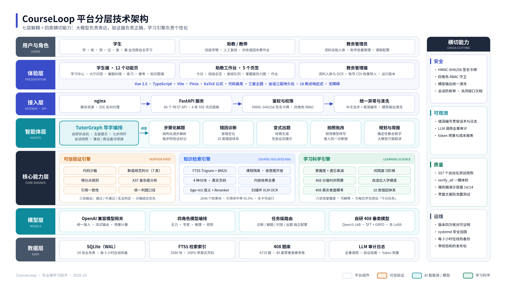

# CourseLoop 技术报告

线上源码基线 c171ac5，提交核对日期 2026-10-09 UTC。本文以提交代码、运行盘点和正式测试证据为依据，分别说明当前实现、历史研发与后续扩展。

线上展示、独立测试验收、下载运行包及GPU实验的对应关系见 [README环境表](../../README.md)。本次修订沿用归档实验结果与数据规模，v1.0交付4810题与2646个检索块的处理后内容数据，见[数据范围](处理后数据交付范围.md)。部分数据来源于南京理工大学计算机科学与工程学院本科生自建数据库。

## 一、问题理解

专业课学习需要将知识解答、过程诊断和学习管理结合起来，区分知识缺失、概念混淆、策略错误和边界遗漏，同时支持依据追溯、进展记录与教师复核。项目围绕“写出思路—获得提示—定位首错—完成纠正—变式复测—记录学情—安排复习”组织完整学习流程。

CourseLoop 面向 408 数据结构、计算机组成原理、操作系统和计算机网络四门课程，围绕学生日常学习及助教／教师干预组织闭环。确定性题目采用算法验证，生成与复杂解释采用模型辅助，待判定结果进入人工复核流程。项目定位为教师与学生的学习支持工具，以学习流程闭环、依据追溯和协同反馈为本轮评价重点；长期教育效果通过后续真人对照实验评估。

## 二、技术路线

第一层统一课程、知识点、题目与学习记录。第二层提供课程隔离的知识检索和规范化判分。第三层由 TutorGraph 编排解题、提示、诊断、重讲和变式。第四层把作答写入错题、掌握度与复习任务，将教师复核结果回流给学生。最后通过单元、HTTP、浏览器、实际模型和压力测试核查流程与风险。

线上采用轻量 SQLite FTS5 和外部模型 API；可选向量分支用 BGE-M3、Chroma 和 BGE Reranker，接口与引用结构统一。历史 QLoRA／GRPO 训练作为独立研发路径。轻量部署支持无 GPU 运行，业务容量与模型计算能力采用独立实验分别验证。

## 三、系统架构

| 层 | 实现 | 主要职责与边界 |
|---|---|---|
| 交互 | Vue 3、TypeScript、路由、Pinia、SSE、Markdown／KaTeX | 四角色工作台、流式显示、提示层级、引用和记录；后端统一执行身份、角色与资源归属校验 |
| API | FastAPI main/auth/core/admin/session 路由 | 请求校验、签名身份、角色与会话归属、流式事件、错误编号 |
| 任务编排 | agents/tutor_graph、solver、error_diagnoser、practice_generator | 结构化解题、首错、渐进提示、重讲、验证式变式及状态恢复 |
| 依据与验证 | rag/ 与 verification/ | 课程隔离召回、来源定位、数值规范、代码子进程、规则与三态结果 |
| 学习服务 | learning/ | 掌握度、画像、摸底、间隔复习、预算、模考、班级干预 |
| 持久化 | core/db.py、SQLite、FTS5、运行日志 | 业务与学习会话、快照、追加记录和检索索引；幂等迁移 |
| 外部依赖 | OpenAI 兼容供应商；可选本地模型 | 提供可配置模型路由；结合超时配置、调用费用管理、结果校验与人工复核组织使用 |

Web接入层提供前端页面和API路由，应用层处理鉴权、业务及数据访问。提交包提供同源回环演示服务器。训练、数据批量处理和运行服务分别组织，支持轻量CPU部署与可选GPU计算。

## 四、核心算法

检索：FTS5 trigram 召回、BM25 排序，按课程和文档类型过滤；可选向量召回与精排。引用保存来源、标题路径和真实页码，Word/TXT 使用标题路径定位。新增资料用课程＋归一化正文哈希去重，撤下移出 raw 扫描范围，恢复重新解析。

导学：五状态与五级提示把整题解析逐层释放，后台预热解析复用结果。提交版实现题目／上下文／课程的入队固定、写回与变式切换共用锁，以及已生成答案的覆盖保护，并通过排队任务回归验证。首错定位结合代码测试／数值判分的客观证据；粗心错因以同知识点历史正确作答为依据。

验证：代码在限时限内存的子进程中运行样例；数值规范按 choice/int/scalar/percent/bits/ipv4net/set 分派；概念题按得分点覆盖，并让模型补解释。VerifyResult.passed 使用 True/False/None，分别表示验证通过、验证未通过和待判定；待判定结果保留人工复核入口。当前代码执行器提供资源限制，面向公网任意代码的部署需进一步配置容器隔离与系统调用、网络和文件访问约束，并开展敌对逃逸测试。

学习：掌握度按正确、难度、提示、稳定概念错误和教师确认更新，应用 14 天半衰期的部分指数衰减；优先级组合薄弱程度、错误频次、久未复习与前置关系。间隔为 1/3/7/14/30 天；错误回退最短，过度依赖提示不进阶，预算在用户层由多课程共享。当前采用可解释的工程启发式参数，长期真人数据标定作为后续研究方向。

模型训练：历史使用 Qwen3-14B 4bit 多任务 QLoRA；assistant-only 损失，rank16/alpha32、最大 4096 tokens、batch2×梯度累积4、学习率2e-4、2 epochs。增量训练采用新数据与旧样本 replay，验证模型路由与冻结评测契约。GRPO 使用可验证奖励，历史实验体现了输出格式合法率的改善；答案一致性与真人学习收益分别采用相应独立评价指标。

## 五、关键模块与源码入口

| 模块 | 入口 | 核心能力与保障措施 |
|---|---|---|
| 身份与授权 | core/security.py、api/auth.py、admin_routes.py | HMAC 签名、学生注册角色约束、逐请求停用校验和盐化密码散列；慢 KDF 加固见后续方向 |
| 学习会话 | api/session_routes.py、core/db.py | 按用户归属读取／删除；会话轮次和 TutorGraph 快照支持续接 |
| 解题纠错 | agents/tutor_graph.py、solver.py、error_diagnoser.py | 首错、提示、变式切换、重讲；变式作答必须按变式题判分 |
| 判分回写 | api/core_routes.py judge_answer/_writeback | 练习与模考共用判分；记录、掌握度和错题关联；通过响应检查与数据库对账共同验收 |
| 复习与预算 | learning/spaced_review.py、study_budget.py、review_service.py | 共享预算、到期窗口、滚动安排与逾期恢复；采用可解释启发式参数 |
| 教学协同 | learning/classroom.py、teaching 路由 | 复核、班级热力图、作业；学生看到复核备注，不下发助教账号名 |
| 资料生命周期 | rag/indexer.py、ingest.py、admin_routes.py | 去重、处理状态留痕、撤下恢复；当前采用 BackgroundTasks，持久队列为后续增强项 |
| 可观测和发布 | core/errors.py、telemetry.py、build_info.py、scripts/ | 错误编号、实际版本核对、快照盘点、校验值和回归报告 |

## 六、实验设计

实验分为七组：源码单元与离线契约；公网只读功能与权限；独立测试混合读写和跨角色协同；真实文本模型 SSE 问答；CPU 验证与检索冒烟；原型浏览器导航与登录；4090D现有FP8基座与LoRA本地推理专项。压力方案使用 10、25、50 个独立账号，50 人持续 30 分钟，20% 判题写入、80% 业务读，思考时间0.1秒，单 worker，提前设定失败率≤1%、P95≤2秒，并逐账号核对实际新增作答。GPU专项按1／4／8并发分别测量首token、完整生成、吞吐及显存，每组5批，性能计时与自然结束的应用问答分开验收。

容量评测快照包含4808题与2646检索块，采用内容表白名单与全新虚构身份。v1.0下载运行包提供4810题与2646块处理后检索内容；历史GPU实验独立采用36题／4讲义原创演示数据。各组输入规模分别登记，用于复现实验条件。实际模型小样本用于链路验收，模型准确率使用独立人工标注评测集评价。

## 七、效果评估

已发布提交版本的实测与证据见 [05测试报告](05-测试报告.md)及 [v1.0证据](../../artifacts/evidence/v1.0/)。容量评测快照统计：四课程4808题，数据结构2138、计组1169、计网935、操作系统566；3024道numeric、1514道unit_test、270道rule。原创微型集实验评价代码样例、canonical判定和四课程检索链路；完整题库质量采用独立金标评测。

原创代码参考解12/12通过；原创单选20/20有可检查金标；四课程检索冒烟4/4非空。历史42例检索报告记录旧语料与来源锚点评测下90.5%到92.9%的变化，按对应实验条件呈现，本轮采用当前证据目录的测试结果。历史467例 SFT／GRPO 指标按 teacher-gold 蒸馏一致性口径记录，训练方法与聚合指标见04模型与算法说明；人工审题正确率采用独立人工金标评价。

## 八、不足分析与后续方向

质量保障与覆盖扩展：资料引用、数值校验、代码测试、规则判分与教师复核共同构成多层质量保障，支持依据追溯、结果检查和争议复核。既有题库中247道 numeric 按当前验证状态组织模型辅助与人工复核，下一阶段通过答案规范化和验证器扩展增加直接自一致性检查覆盖。掌握度与间隔参数采用可解释的工程启发式，后续结合真人样本和对照设计开展参数标定与长期学习收益评价。

容量与工程演进：提交版将作答、掌握度读改写和错题处理纳入BEGIN IMMEDIATE原子事务，通过最多8个普通连接、独立写者通道、短同步请求连接复用、热查询索引和课程范围CTE物化优化业务链路。单账号累积及10/25/50用户容量已分别验收，结果见05测试报告；多机容量按独立实验扩展。当前作答按提交次数记录，角色更新在重新登录后生效，资料解析采用BackgroundTasks并保存任务状态；服务重启时保留的running记录需由管理员核查处理。下一阶段增加请求幂等键、会话权限刷新、持久任务队列与重启恢复机制，并开展慢KDF密码散列、会话时长和登录限流加固。

视觉与模型扩展：视觉API已通过独立智增增端点接入qwen3-vl-30b-a3b-instruct，采用忠实转写提示，保留学生原有作答，并以[?]标记模糊内容。真实原创印刷体图片与公网拍照流程验收通过；广泛手写、复杂公式和扫描件准确率作为下一阶段专项评测。交付提供源码、方法与完整处理后内容数据；4090D现有FP8基座与LoRA推理计时、显存、吞吐及应用接入已完成，见08，与云端API端到端时延分别报告。复训、向量模型和双V100同条件对比按07扩展协议开展。
