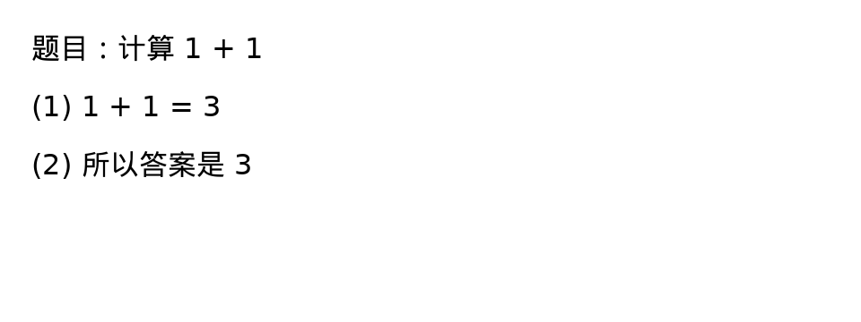

# CourseLoop 正式提交版本案例展示

正式交付版本v1.0。完整处理后内容、测试环境容量快照与原创轻量部署案例分别标明数据规模和证据。

## 一、确定性判题与教学协同

v1.0完整内容案例：题目ID17，题干“以下关于数据结构的描述中，哪一项是正确的？”选项A“数据结构只包括线性结构，不包括非线性结构”，B“数据结构是存储和组织数据的方式”，C“数据结构的选择与算法无关”，D“数据结构只能用于存储静态数据，无法处理动态数据”。学生先提交A、纠正后提交B，86项功能／权限／协同检查通过，见[本次functional.json](../../artifacts/evidence/v1.0/processed-data/functional.json)。历史测试环境4808题快照同题案例见[functional-final.json](../../artifacts/evidence/v1.0/functional-final.json)。

原创轻量部署案例：同为ID17，题干为“以下哪种数据结构遵循后进先出？”，选项A栈、B队列、C数组的任意访问、D哈希表；学生先提交B、纠正后提交A，见 [functional-runtime.json](../../artifacts/evidence/v1.0/functional-runtime.json)及 [原创生成代码](../../scripts/submission_prepare.py)。题号按数据环境区分，正式下载包采用前述完整内容案例。

处理：确定性判错 → 作答/错题/掌握度回写 → 学生申请复核 → 助教和教师处理 → 学生读回反馈 → 正确复测 → 学情与复习计划 → 下发针对性作业并再次作答。

输出：两环境均验证错答passed=False、纠正passed=True；独立测试案例的学情作答数23→25。完整响应与断言见上述对应证据。

## 二、同账号多设备作答

输入：每轮10客户端共20次正确答案，初始掌握度0.2618。处理：数据库写锁内读取当前值、计算增量、保存作答与画像，一次提交。输出：5轮共100次作答全部保存，实际掌握度均与串行计算一致。见same-user-final.json。

## 三、导学闭环与权限边界

模型桩闭环：提交题目、分级提示、首错与错因、重讲、变式复测、错题与学情、复习及人工复核，验证流程编排与学习记录回流。权限校验按预期返回匿名个人接口401、学生教学/教务越权403、伪造令牌401、其他学生会话读取/删除404。见smoke.json及functional-final.json。在线演示服务已启用真实视觉API并完成独立拍照验收，见第五节；自行部署提供无密钥基础模式与配置API后的模型模式。模型准确率另用独立标注集评价。

## 四、界面证据与后续专项展示

原创轻量部署在全新Python环境完成86项功能／权限／教学协同检查及23项浏览器验收，JS错误0；配套截图见ui-final-runtime/。完整处理后内容完成86项功能及100次同账号并发验收，功能与源码回归证据见05报告。云GPU独立部署的浏览器证据按08专项报告列示，各组分别对应实际部署。截图使用虚构身份，并与相应接口测试共同作为证据。演示视频时长约4分39秒，入口见[演示材料与文件校验](演示材料.md)；广泛手写与复杂图片效果评测、长期真人效果按专项计划开展。4090D上的现有FP8基座与LoRA本地推理计时、批量吞吐和应用接入已完成专项验收，见08报告；GPU训练成本、向量模型和跨设备对比按07协议扩展。已有原创印刷体图片真实API验收见第五节。

## 五、真实视觉拍照批改

输入：原创图片包含错误算式1+1=3。处理：智增增视觉模型忠实转写，保留学生原错误，再交给既有文本诊断链路，不直接篡改转写结果。

输出：2张原创图片的限定转写检查通过；公网SSE最终判错与结束事件验证通过=True。原始响应见vision-live.json。本例展示印刷体错误算式的真实转写与诊断链路，手写准确率通过后续专项评测评价。

## 六、真实文本模型：检索依据与流式讲解

环境：4090D独立部署，Qwen3-14B-FP8＋LoRA，原创FTS讲义；本例是实际模型应用问答，学习记录回写与纠正复测采用前述独立案例评价。

输入：“简要解释栈与队列的区别，各给一个应用场景。”

处理：课程ds-algo范围检索→返回“原创演示讲义”的引用事件→实际GPU模型流式输出→final、verify及done事件完成。引用片段包含“栈遵循后进先出（LIFO），队列遵循先进先出（FIFO）。括号匹配可以用栈；广度优先搜索使用队列。”TXT资料通过标题定位，page_start／page_end均为0。

实际final响应：“栈和队列的区别在于访问顺序：栈是后进先出（LIFO），队列是先进先出（FIFO）。栈的应用场景包括括号匹配；队列的应用场景包括广度优先搜索。”

结果：首token390.67ms，总耗时4176.56ms；citation、final、verify及done事件完整，案例passed=true。另一个操作系统案例对比LRU与FIFO，首token109.39ms、总耗时3483.83ms，实际回答与原创讲义相应定义一致。上述通过状态评价应用链路与脚本断言，回答文本及引用保留供评委核查。

原始输入、逐事件响应与计时见 [application-sse.json](../../artifacts/evidence/v1.0/gpu-4090d/application-sse.json)。
